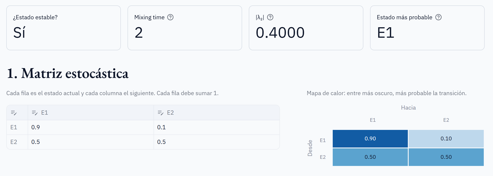
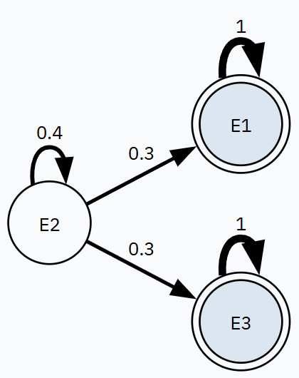
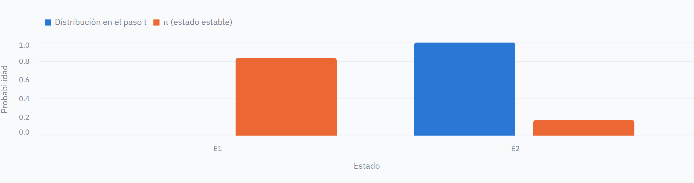

# Simulador de cadenas de Markov


Aplicación web que analiza una cadena de Markov a partir de su matriz estocástica: determina si se alcanza un estado estable, calcula la distribución estacionaria y el **mixing time**, y contrasta la teoría con una simulación Monte Carlo.

Trabajo Final de **Procesos Estocásticos** (2026), desarrollado por Juan José Ospina y Geronimo Gaviria.



## Contenido

- [El taller](#el-taller)
- [Qué es el mixing time](#qué-es-el-mixing-time)
- [Cómo se resuelve cada ítem](#cómo-se-resuelve-cada-ítem)
- [Ejemplo resuelto a mano](#ejemplo-resuelto-a-mano)
- [Validación](#validación)
- [Instalación](#instalación)
- [Uso](#uso)
- [Estructura del proyecto](#estructura-del-proyecto)
- [Alcance y límites](#alcance-y-límites)
- [Documentación](#documentación)
- [Referencias](#referencias)

## El taller

**Objetivos:**

1. Familiarizarse con el concepto de mixing time.
2. Desarrollar un simulador de cadenas de Markov que permita encontrar la distribución estacionaria y el tiempo de mezcla.

**Requisitos del programa y dónde se cumple cada uno:**

| # | Requisito del enunciado | Dónde está | Función principal |
|---|---|---|---|
| 1 | Solicitar al usuario la matriz estocástica | Sección 1 de la app | `leer_matriz`, `validar_matriz` |
| 2 | Determinar si se puede alcanzar un estado estable | Sección 2 | `analizar_cadena` |
| 3 | Si el ítem 2 es positivo, calcular y mostrar la distribución estable | Sección 3 | `distribucion_estacionaria` |
| 4 | Calcular y mostrar el mixing time | Sección 4 | `mixing_time` |
| 5 | Incluir una funcionalidad particular | Página "Caso real: clima de Medellín" y sección 5: simulación Monte Carlo | `estimar_matriz`, `frecuencia_a_k_pasos`, `simular` |

Todas las funciones están en [`simulador/markov.py`](simulador/markov.py). La interfaz tiene dos páginas: [`pagina_simulador.py`](simulador/pagina_simulador.py) y [`pagina_clima.py`](simulador/pagina_clima.py).

**Entregables:**

| Entregable | Archivo |
|---|---|
| Reporte de especificación | [`documentos/Reporte_especificacion.docx`](documentos/Reporte_especificacion.docx) |
| Programa | Este repositorio |
| Exposición | [`documentos/Diapositivas.pptx`](documentos/Diapositivas.pptx) y [`documentos/Guion_de_exposicion.md`](documentos/Guion_de_exposicion.md) |
| Exposición del caso real | [`documentos/Caso_real_diapositivas.pptx`](documentos/Caso_real_diapositivas.pptx) y [`documentos/Guion_caso_real.md`](documentos/Guion_caso_real.md) |

## Qué es el mixing time

**Objetivo.** El mixing time mide cuántos pasos necesita una cadena de Markov para olvidar su estado inicial, es decir, para que su distribución quede lo bastante cerca de la distribución estacionaria π, sin importar en qué estado empezó. "Lo bastante cerca" lo define una tolerancia ε.

**Cómo se mide la cercanía.** Se usa la distancia de variación total entre dos distribuciones, que es la mayor diferencia de probabilidad que pueden asignarle a un mismo evento:

$$\lVert \mu - \nu \rVert_{TV} = \tfrac{1}{2} \sum_x \lvert \mu(x) - \nu(x) \rvert$$

**Cómo se calcula.** La fila x de Pᵗ es la distribución de la cadena después de t pasos si arrancó en x. Se toma el peor caso entre todos los estados iniciales, y el mixing time es el primer paso en que esa distancia baja de ε:

$$d(t) = \max_x \lVert P^t(x, \cdot) - \pi \rVert_{TV}, \qquad t_{mix}(\varepsilon) = \min\{\, t \ge 0 : d(t) \le \varepsilon \,\}$$

Por defecto se usa ε = 1/4, el valor convencional en la literatura, y el usuario puede cambiarlo.

## Cómo se resuelve cada ítem

### Ítem 1. Solicitar la matriz estocástica

El usuario elige en la barra lateral una matriz de ejemplo o una personalizada de hasta 12 estados, y la edita en una tabla.

- Cada casilla acepta decimales (`0.25` o `0,25`) y fracciones (`1/3`). Las fracciones evitan que una fila de tercios escrita como `0.3333` sume 0.9999 y se rechace.
- Antes de calcular se valida que la matriz sea cuadrada, que no tenga casillas vacías ni valores negativos, y que cada fila sume 1 (con tolerancia de 10⁻⁹ por redondeo).
- Si algo falla, el programa indica la casilla o la fila exacta.

### Ítem 2. Determinar si se alcanza un estado estable

Una cadena finita converge a una única distribución, sin importar el estado inicial, cuando tiene **exactamente una clase cerrada** y esa clase es **aperiódica**. Los estados transitorios no impiden la convergencia, porque la cadena termina abandonándolos.

El programa lo decide en cuatro pasos:

1. **Grafo:** hay una flecha i → j cuando P(i, j) > 0.
2. **Clases comunicantes:** con el algoritmo de Warshall se calcula qué estados alcanzan a cuáles; dos estados están en la misma clase si cada uno alcanza al otro.
3. **Clases cerradas:** son aquellas de las que no sale ninguna flecha.
4. **Período:** se recorre la clase cerrada con BFS y se calcula el máximo común divisor de nivel(u) + 1 − nivel(v) en cada flecha u → v. Equivale al MCD de las longitudes de los ciclos.

| Caso | ¿Se alcanza? | Qué muestra el programa |
|---|---|---|
| Una clase cerrada, período 1 | Sí | Calcula π y el mixing time |
| Una clase cerrada, período 2 o más | No | Indica que la cadena oscila y su período |
| Dos o más clases cerradas | No | Indica que el resultado depende del estado inicial y lista las clases |

Además, dibuja el grafo de transiciones con las clases cerradas resaltadas.



### Ítem 3. Calcular y mostrar la distribución de estado estable

Solo se calcula si el ítem 2 es positivo. Se resuelve el sistema

$$\pi P = \pi, \qquad \sum_i \pi_i = 1$$

Equivale a (Pᵀ − I)π = 0 más la ecuación de normalización: n + 1 ecuaciones con n incógnitas, que se resuelven por mínimos cuadrados (`numpy.linalg.lstsq`). El resultado se muestra en una tabla y en un gráfico de barras.

### Ítem 4. Calcular y mostrar el mixing time

Se aplica el procedimiento de la sección [Qué es el mixing time](#qué-es-el-mixing-time) de forma iterativa:

1. Empezar con t = 0 y P⁰ = I (matriz identidad).
2. Calcular d(t).
3. Si d(t) ≤ ε, el mixing time es t.
4. Si no, multiplicar Pᵗ⁺¹ = Pᵗ · P y volver al paso 2.

Como d(t) nunca aumenta con t, el primer t que cumple la condición es el mínimo. Si no se alcanza en 100 000 pasos, el programa lo avisa en vez de inventar un número.

La app muestra:

- El valor del mixing time.
- La curva d(t) con ε y t_mix marcados.
- El segundo valor propio |λ₂|, que explica la velocidad, porque d(t) decae aproximadamente como |λ₂|ᵗ.
- Una animación paso a paso de cómo la distribución se acerca a π.



### Ítem 5. Funcionalidad particular: caso real con el clima de Medellín

La funcionalidad principal lleva el simulador a datos reales. En vez de escribir la matriz a mano, **la estimamos con la lluvia diaria de Medellín** (1096 días, del 1 de enero de 2023 al 31 de diciembre de 2025, de la API de clima histórico de [Open-Meteo](https://open-meteo.com/)) y respondemos una pregunta concreta: **¿en cuántos días se olvida el clima de hoy?**

| Ítem del taller | Cómo se aplica al clima |
|---|---|
| 1. Matriz | Cada día es un estado: seco (< 1 mm), lluvia ligera (1 a 10 mm) o lluvia fuerte (≥ 10 mm). P se estima contando qué tipo de día siguió a cada uno. |
| 2. Estado estable | Los tres estados se comunican y la cadena es aperiódica: sí converge. |
| 3. π | A largo plazo: 29.4 % de días secos, 47.2 % de lluvia ligera y 23.4 % de lluvia fuerte, igual a la frecuencia real. |
| 4. Mixing time | 2 días con ε = 1/4 (3 días con ε = 0.1 y 6 con ε = 0.01). |
| Validación | Se compara lo que predice Pᵏ con lo que pasó de verdad k días después. |

**Hallazgo.** Al día siguiente el modelo coincide exacto con la realidad, pero después se separan: 5 días después de un día de lluvia fuerte, el modelo predice 24.2 % de lluvia fuerte y en la realidad fue 31.9 %. El clima real recuerda más que la cadena, porque las temporadas de lluvia duran semanas y un modelo que solo mira el día anterior no las capta. El mixing time del modelo es un límite inferior.

Los datos están guardados en [`datos/clima_medellin.csv`](datos/clima_medellin.csv), así que la app funciona sin internet, y se pueden volver a descargar con `uv run python datos/descargar_clima.py`.

### Ítem 5 (complemento). Simulación Monte Carlo

Además del cálculo exacto, el programa simula la cadena con N caminantes:

1. Todos arrancan en el estado inicial elegido.
2. En cada paso, cada caminante sortea un número u entre 0 y 1, y el tramo de la fila acumulada de P donde cae u decide su siguiente estado.
3. Se cuenta cuántos caminantes hay en cada estado y se compara esa distribución empírica con la teórica.

Sirve como verificación independiente del álgebra. El ruido de la simulación baja como 1/√N: con 10 veces más caminantes se reduce unas 3 veces.

## Ejemplo resuelto a mano

Para la matriz

$$P = \begin{pmatrix} 0.9 & 0.1 \\ 0.5 & 0.5 \end{pmatrix}$$

se tiene π = (5/6, 1/6) = (0.8333, 0.1667), los valores propios son 1 y 0.4, y d(t) = (5/6) · 0.4ᵗ:

| t | d(t) | ¿d(t) ≤ 1/4? |
|---|---|---|
| 0 | 0.8333 | No |
| 1 | 0.3333 | No |
| 2 | 0.1333 | Sí |

Por lo tanto, t<sub>mix</sub>(1/4) = 2, igual que el resultado del programa. Este caso también está como prueba automática.

## Validación

- **57 pruebas automáticas** escritas antes del código: 45 cubren la lógica, incluida la estimación con datos reales, y 12 las dos páginas, usando el probador de Streamlit.
- **Dos cadenas calculadas a mano** que coinciden con el programa: la regular de 2 estados (mixing time 2) y la absorbente con transitorios (mixing time 5).
- **Prueba de las pruebas:** se introdujeron 19 errores a propósito en la lógica y las pruebas detectaron 16. Los 3 restantes son protecciones contra redondeo casi imposibles de provocar.

## Instalación

Requisitos: [uv](https://docs.astral.sh/uv/). Si no tienes Python 3.12 o superior, uv lo instala solo.

```bash
git clone https://github.com/juann11/Procesos_estocasticos.git
cd Procesos_estocasticos
uv sync
```

## Uso

```bash
uv run python -m streamlit run simulador/app.py
```

Abre `http://localhost:8501` en el navegador, o usa la versión en línea: https://markov-medellin.streamlit.app. En el menú de la izquierda hay dos páginas: **Simulador**, donde se elige una matriz de ejemplo o una personalizada y la tolerancia ε (para cambiar un valor, doble clic en la casilla), y **Caso real: clima de Medellín**.

| Ejemplo | Resultado esperado |
|---|---|
| Regular (2 estados) | Converge. π = (0.8333, 0.1667), mixing time 2 |
| Regular (3 estados) | Converge. π = (0.3, 0.3, 0.4), mixing time 1 |
| Absorbente con transitorios | Converge. π = (0, 0, 1), mixing time 5 |
| Periódica (2 estados) | No converge: período 2 |
| Dos estados absorbentes | No converge: dos clases cerradas |

Para correr las pruebas:

```bash
uv run python -m pytest
```

## Estructura del proyecto

```
.
├── simulador/
│   ├── app.py               # Menú con las dos páginas
│   ├── pagina_simulador.py  # Simulador: matriz escrita por el usuario
│   ├── pagina_clima.py      # Caso real: clima de Medellín
│   └── markov.py            # Lógica: validación, clases, período, π, mixing time, estimación y simulación
├── datos/
│   ├── clima_medellin.csv   # Lluvia diaria de Medellín 2023-2025
│   └── descargar_clima.py   # Script que descarga los datos
├── pruebas/
│   ├── test_markov.py   # Pruebas de la lógica
│   ├── test_app.py      # Pruebas de la página del simulador
│   └── test_clima.py    # Pruebas de la página del caso real
├── documentos/
│   ├── Reporte_especificacion.docx
│   ├── Diapositivas.pptx              # Presentación completa (con notas del orador)
│   ├── Guion_de_exposicion.md         # Qué decir en cada diapositiva
│   ├── Caso_real_diapositivas.pptx    # Presentación solo del caso real
│   ├── Guion_caso_real.md             # Guion del caso real
│   └── imagenes/        # Capturas usadas en este README
├── .streamlit/config.toml   # Tema y fuentes de la interfaz
└── pyproject.toml
```

La lógica (`markov.py`) no depende de la interfaz, así que se prueba por separado.

## Alcance y límites

| Aspecto | Límite | Por qué |
|---|---|---|
| Estados | Hasta 12 | La tabla sigue legible |
| Grafo | Hasta 8 estados | Con más, las flechas se vuelven ilegibles |
| Mixing time | 100 000 pasos | Avisa si la cadena no alcanza ε |
| Tolerancia ε | De 0.001 a 0.5 | Evita que el redondeo domine |
| Simulación | Hasta 1000 pasos y 100 000 caminantes | Mantiene la app ágil |

El programa trabaja con cadenas de estados finitos y probabilidades de transición que no cambian con el tiempo.

## Documentación

- [Reporte de especificación](documentos/Reporte_especificacion.docx)
- [Diapositivas](documentos/Diapositivas.pptx) y su [guion](documentos/Guion_de_exposicion.md)
- [Diapositivas del caso real](documentos/Caso_real_diapositivas.pptx) y su [guion](documentos/Guion_caso_real.md)

## Referencias

- Levin, D. A., Peres, Y. y Wilmer, E. L. *Markov Chains and Mixing Times*, 2.ª ed. American Mathematical Society, 2017.
